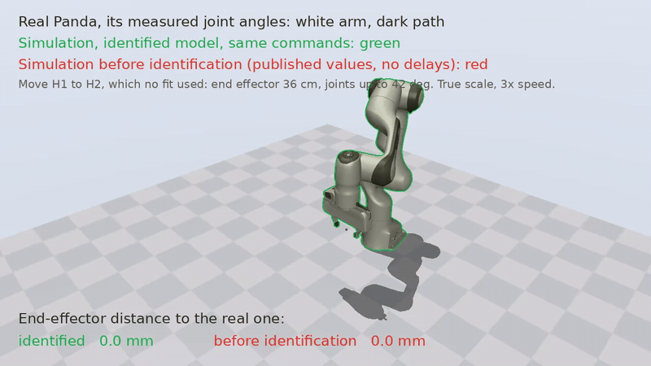

# panda-sysid

System identification of the Franka Emika Panda for MuJoCo. It plans a
recording campaign (36 minutes of motion) on your own robot, runs it with
checks before every motion, and fits a MuJoCo model of your arm to the
recordings:

- the **link inertials** of links 1-7, from the joint torque sensors;
- per joint, **dry friction, viscous damping and armature**, under a joint
  impedance controller that you run through libfranka's torque interface;
- the **delays of the torque controller** (late joint velocity, libfranka's
  filter and rate limit, a late torque), which a simulation must reproduce;
- the range of the **torque bias** that the robot's gravity compensation
  leaves, which a simulation should randomize.



Our Panda on a move that no fit used (end effector 36 cm, joints up to 42
deg): its measured joint angles (white arm, dark path) and a simulation of
the identified model on the same commands (green), at true scale. The end
effectors stay 3.5 mm apart on average ([MP4](results/replay/real_vs_sim.mp4);
all results in [results/README.md](results/README.md)).

Every motion is simulated, checked and shown as a video before it runs on the robot.

The model is the Panda with the Franka Hand from
[MuJoCo Menagerie](https://github.com/google-deepmind/mujoco_menagerie). The
result is one JSON file, `model.json`:

```python
import numpy as np
from panda_sysid import model, simmodel

sim = simmodel.load("results/model.json")       # ours; or your own
spec = model.make_spec(kp=40.0, kd=20.0, dynamics=sim.dynamics)
mj_model = spec.compile()                       # arm + hand, joint impedance actuators
sim.delays                                      # Delays(dq_lag=3, torque_lag=2, cutoff=100.0, rate_limit=1.0)
sim.draw_bias(np.random.default_rng())         # a torque bias for one episode (N m per joint)
```

`panda_sysid.delayed.rollout` is a reference implementation of the
controller with its delays around `mj_step`.

## How it works

**The controller.** The robot runs a joint impedance,
`tau = kp (q_d - q) - kd dq`, computed at 1 kHz by `real/joint_impedance`
from the measured state and sent through libfranka's torque interface; the
robot adds gravity compensation. In MuJoCo (`panda_sysid.model`), each
joint has a position actuator with the same gains and torque limit, and
every body is gravity compensated. A rollout of a logged `q_d` therefore
predicts the logged `q`. The forward kinematics match the robot's to 0.003
mm (`results/workspace/corners.json`).

On the robot, the signal path is slower than MuJoCo's actuator. From the
logs: the robot's `dq` lags the true joint velocity by 2.5-3.25 ms;
libfranka low-pass filters the torque and limits its rate; the robot
applies a command about 2 ms after it is sent. `panda_sysid.delayed` rolls
the controller out with all of these around `mj_step`. A fit without them
puts the delays into lower armature and damping. At kd 20 the wrist joints
sit close to the stability limit these delays set (with the published
armature and no friction, joint 7 goes unstable).

**The campaign** (`panda_sysid.campaign`, 19 runs, 36 min of motion). The
end effector stays inside a box that you record by hand-guiding the arm to
eight corners.

- *reference*: one fixed one-minute session at the box center P1, at the
  start, after the Fourier runs, after the pose sessions and at the end (the
  joints warm up), and once more with libfranka's filter off. Run-to-run
  repeatability is the floor of any model's error.
- *Fourier*: three large periodic motions of all joints around P1 under
  Franka's joint position controller, each run cold and warm. They excite
  the link inertials. Designed by random search for the smallest condition
  number of the base regressor, within the box, joint limits, Franka's
  speed, acceleration and jerk limits, clearance from the table and no
  self-collision.
- *pose sessions* at six poses spread over the box and two held-out ones:
  graded steps from inside the friction dead band to beyond it, sweeps at
  5, 20 and 60 mrad/s, targets that jump every 20 ms like a learned policy's,
  multisines. Each starts with a slow straight-line move from the last pose.

Each run is simulated with the delayed controller before it runs, and
checked against the player's abort thresholds (with a factor 2 margin), the
box, joint limits, self-collision, clearance from the base plane, and
singularities (Franka's Cartesian reflex). At run time each run is planned
again from the robot's measured state.

**Link inertials** (`panda_sysid.inertial`). The torque sensors sit
between gearbox and link, so `tau_J` sees the link side only: the rigid-body
dynamics, linear in the standard inertial parameters
(`panda_sysid.regressor`), plus friction after the sensor. A least-squares fit
is regularized by the log-det divergence of each link's pseudo-inertia
from Franka's values (Lee, Wensing and Park, T-RO 2020): it stays physically
consistent, keeps unobservable directions at the published values, and is
convex. The hand keeps the values entered in Desk.

**Joints** (`panda_sysid.fit`). The impedance runs are cut into 4 s chunks;
each is rolled out from its measured state under the logged `q_d`, and
Levenberg-Marquardt (`mujoco.sysid`) fits per joint armature, dry friction,
damping and a constant torque bias to the errors of `q` and `dq` at every
millisecond. The robot compensates gravity with Franka's model, not with
the identified one, so the difference (logged by the players) is added to
the torque. MuJoCo's default solver tolerance makes the stiff dry friction
noisy under finite differences, so the rollouts use 1e-12 and a step of
1e-4. **Bias**: with the joint values fixed, each run gets its own bias;
their range over all runs is the bias range.

## Calibrate your own Panda

You need: a Panda with FCI, a Linux PC on a direct Ethernet link to its
Control box, libfranka in the version that your robot's system version
needs ([compatibility](https://frankaemika.github.io/docs/compatibility.html)),
Python 3.10 or newer with [uv](https://docs.astral.sh/uv/), ffmpeg, and for
the videos a GPU with EGL. The fits run on CPU cores (the joint fit takes
about 20 minutes on 100 cores).

The tools assume **the Franka Hand** with its Desk default end-effector
settings. With another end effector, change `panda_sysid.model._franka_hand`
and enter matching mass and center of mass in Desk: the robot's gravity
compensation and the inertial fit both use them.

**Safety.** Every motion runs only after you have looked at its simulation.
Keep the user stop at hand. The players abort on tracking error, speed,
torque and joint limits, and the robot's own collision reflexes stay on,
but the planner does not know your table or fixtures: the workspace box is
how you tell it where it may go.

```bash
git clone <this repository> panda-sysid && cd panda-sysid
uv sync
cmake -S real -B real/build -DCMAKE_PREFIX_PATH=$HOME/opt/libfranka-0.8.0 -DCMAKE_BUILD_TYPE=Release
cmake --build real/build
real/build/stream_state 172.16.0.2 1 1          # the robot's state, once
```

1. **Record the workspace.** Press the user stop, then hand-guide the end
   effector to eight corners of the space it may use and record each pose
   (a browser view shows the arm):
   ```bash
   uv run --extra viewer python scripts/record_poses.py --out runs/corners.json
   uv run python scripts/workspace_box.py --poses runs/corners.json --out runs/workspace_box
   ```
2. **Plan the campaign** and watch it (poses, Fourier design, every run simulated and checked):
   ```bash
   uv run python scripts/plan_campaign.py --box runs/workspace_box.json --video --out runs/campaign
   ```
   It writes `overview.mp4`, a video per run and `campaign.json`; every run must pass its checks.
3. **Move the arm to P1** on a straight line, watch the video, then run it:
   ```bash
   real/build/stream_state 172.16.0.2 1 1 > runs/state.txt
   uv run python scripts/move.py --state runs/state.txt --to-pose P1 --poses runs/campaign/poses.json \
       --box runs/workspace_box.json --out runs/moves/to_p1
   real/build/joint_position 172.16.0.2 runs/moves/to_p1/traj.csv runs/moves/to_p1/log.csv
   ```
4. **Run the campaign.** Each run is planned again from the measured state,
   checked, and run; any failure stops the sequence. `--confirm` asks for
   Enter before each motion; `--runs` does some runs only.
   ```bash
   uv run python scripts/run_campaign.py --box runs/workspace_box.json --out runs/campaign --confirm
   ```
   After a reflex, `real/build/recover 172.16.0.2` clears it without moving.
5. **Fit**, in order (each step writes a `model.json` that the next one starts from):
   ```bash
   uv run python scripts/fit_inertial.py --logs runs/campaign --out runs/fit/inertial
   uv run python scripts/identify.py --logs runs/campaign --model runs/fit/inertial/model.json \
       --gravity-offset --fix armature1,armature2,armature3,armature4 --out runs/fit/joints
   uv run python scripts/bias_per_run.py --logs runs/campaign --model runs/fit/joints/model.json \
       --out runs/fit/bias --model-out runs/fit/model.json
   ```
6. **Validate** on the held-out poses against the robot's own repeatability:
   ```bash
   uv run python scripts/validate.py --logs runs/campaign --model published:nominal \
       --model "identified, own bias:runs/fit/model.json:1:runs/fit/bias/bias_per_run.json" \
       --out runs/fit/validate
   ```

`results/run_all.sh` is steps 5 and 6 on our logs, plus the errors on the
large moves and the video (`scripts/replay_video.py`); `results/README.md`
describes what came out.

## Data

The logs of our campaign (19 runs, every robot state at 1 kHz, 0.9 GB
compressed) are not published yet. `results/run_all.sh` reruns every fit
from them in `data/campaign/<run>/` (`log.csv.gz`, `plan.json`); your own
campaign has the same layout.

A log (`real/joint_impedance`, `real/joint_position`) is a CSV with robot
time `t_ms` and per joint `q`, `dq`, the target `qd`, the commanded torque,
`tau_J`, `tau_J_d`, `dtau_J`, the external torque estimate, motor `theta`
and `dtheta`, and Franka's gravity torque for the Desk load, plus the
command success rate.

## Layout

```
src/panda_sysid/   robot (arm, Dynamics), model (arm + hand under joint impedance), simmodel (model.json),
                   delayed (controller with delays), fit (logs, joint fit), regressor and inertial
                   (link inertials), excitation (sessions), campaign (runs, poses, Fourier design, checks),
                   checks (IK, safety checks), workspace (box), realrun (run summaries), video
scripts/           record_poses, workspace_box, plan_campaign, move, run_campaign,
                   fit_inertial, identify, bias_per_run, validate, replay_video
real/              C++ programs on libfranka: joint_impedance, joint_position, stream_state, recover
results/           our Panda: workspace, inertial, joints, bias, validate, replay, model.json;
                   run_all.sh makes them from the logs
tests/             fast checks (uv run --group dev pytest)
```

## Limits

- Tested on one Panda with libfranka 0.8.0 only. The FR3 has other limits and
  is not supported.
- The impedance runs are slow (joints at most 0.19 rad/s; the Fourier runs
  reach 0.93 rad/s under Franka's position controller). Armature of joints
  1-4 is not identifiable from them, and the model is not validated for fast
  motion under joint impedance.
- The torque bias depends on the pose and is modeled as a random constant.
- Without a real-time kernel, 0.3-0.8% of the 1 ms ticks were missed; the
  logs mark them and the fits skip them.

## Credits

The arm and hand models are from MuJoCo Menagerie (Apache-2.0, see
`src/panda_sysid/assets/franka_emika_panda/LICENSE`). The published inertials
are Franka's (franka_description); the nominal friction is from C. Gaz et
al., "Dynamic Identification of the Franka Emika Panda Robot With Retrieval
of Feasible Parameters Using Penalty-Based Optimization", RA-L 2019; the
nominal armature from Menagerie's FR3. The inertial fit follows T. Lee, P.
Wensing and F. Park, "Geometric Robot Dynamic Identification: A Convex
Programming Approach", T-RO 2020. License: Apache-2.0.
