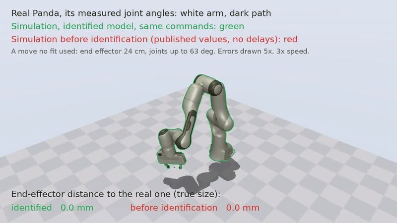
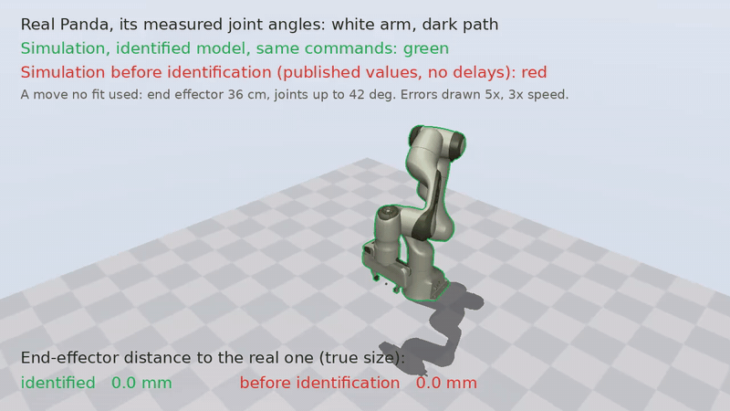
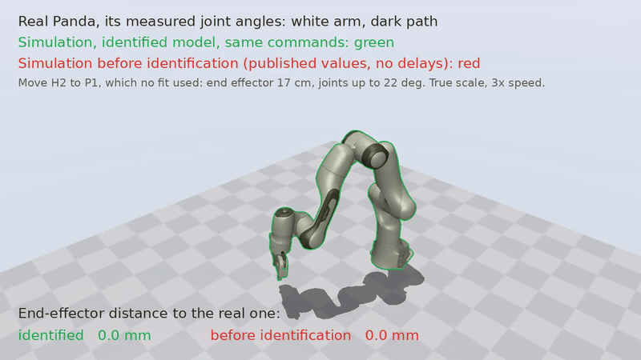

# panda-sysid

System identification of the Franka Emika Panda for MuJoCo. It plans a
36-minute recording campaign on your robot, runs it with checks before every
motion, and fits a MuJoCo model of your arm:

- **link inertials**, from the joint torque sensors;
- per joint **dry friction, damping and armature**, under a joint impedance
  controller run through libfranka's torque interface;
- the **delays of the torque controller**, which a simulation must reproduce;
- the range of the **torque bias** the robot's gravity compensation leaves.

Our Panda on the three moves no fit used, at true scale. White: the robot's
measured joint angles; green: the identified model; red: the published values
without delays. Numbers are the mean end-effector error of green and red.

**P6 to H1** (24 cm, joints up to 63 deg): 2.7 mm and 6.2 mm



**H1 to H2** (36 cm, joints up to 42 deg): 3.5 mm and 14.5 mm



**H2 to P1** (17 cm, joints up to 22 deg): 2.5 mm and 8.8 mm



All results: [results/README.md](results/README.md).

## Use the model

The model is the Panda with the Franka Hand from
[MuJoCo Menagerie](https://github.com/google-deepmind/mujoco_menagerie); the
result is one file, `model.json`.

```python
import numpy as np
from panda_sysid import model, simmodel

sim = simmodel.load("results/model.json")       # ours; or your own
mj_model = model.make_spec(kp=40.0, kd=20.0, dynamics=sim.dynamics).compile()
sim.delays                                      # Delays(dq_lag=3, torque_lag=2, cutoff=100.0, rate_limit=1.0)
sim.draw_bias(np.random.default_rng())         # a torque bias for one episode (N m per joint)
```

`panda_sysid.delayed.rollout` steps the controller with its delays around `mj_step`.

## How it works

- **Controller.** The robot runs `tau = kp (q_d - q) - kd dq` at 1 kHz
  (`real/joint_impedance`) and adds gravity compensation; MuJoCo has a
  position actuator per joint with the same gains. On the robot, `dq` is 3 ms
  late, libfranka filters the torque and limits its rate, and a command acts
  2 ms after it is sent; `panda_sysid.delayed` models all of it.
- **Campaign** (`panda_sysid.campaign`, 19 runs). Reference sessions at the
  box center for the repeatability floor, Fourier runs under Franka's position
  controller for the inertials, and sessions at six poses plus two held-out
  ones (H1, H2) for the joints. Every run is simulated and checked before it
  runs, and planned again from the measured state.
- **Link inertials** (`panda_sysid.inertial`). Least squares on `tau_J`,
  kept physically consistent by a log-det divergence from Franka's values
  (Lee, Wensing and Park, T-RO 2020).
- **Joints** (`panda_sysid.fit`). Levenberg-Marquardt (`mujoco.sysid`) on
  4 s rollouts of the impedance runs, from the published values; then a bias
  per run, whose range over all runs is the bias range.

## Calibrate your own Panda

You need a Panda with FCI on a direct Ethernet link, libfranka for your
system version, Python 3.10+ with [uv](https://docs.astral.sh/uv/), ffmpeg,
and a GPU with EGL for the videos. The tools assume the Franka Hand with its
Desk defaults (another end effector: change `panda_sysid.model._franka_hand`
and Desk's load).

**Safety.** Watch each motion's simulation before it runs and keep the user
stop at hand. The planner knows only the workspace box, not your table or
fixtures.

```bash
git clone <this repository> panda-sysid && cd panda-sysid
uv sync
cmake -S real -B real/build -DCMAKE_PREFIX_PATH=$HOME/opt/libfranka-0.8.0 -DCMAKE_BUILD_TYPE=Release
cmake --build real/build
```

1. **Record the workspace**: hand-guide the end effector to eight corners.
   ```bash
   uv run --extra viewer python scripts/record_poses.py --out runs/corners.json
   uv run python scripts/workspace_box.py --poses runs/corners.json --out runs/workspace_box
   ```
2. **Plan the campaign** and watch its videos; every run must pass its checks.
   ```bash
   uv run python scripts/plan_campaign.py --box runs/workspace_box.json --video --out runs/campaign
   ```
3. **Move the arm to P1**, watch the video, run it.
   ```bash
   real/build/stream_state 172.16.0.2 1 1 > runs/state.txt
   uv run python scripts/move.py --state runs/state.txt --to-pose P1 --poses runs/campaign/poses.json \
       --box runs/workspace_box.json --out runs/moves/to_p1
   real/build/joint_position 172.16.0.2 runs/moves/to_p1/traj.csv runs/moves/to_p1/log.csv
   ```
4. **Run the campaign** (`--confirm` asks before each motion; after a reflex,
   `real/build/recover 172.16.0.2` clears it without moving).
   ```bash
   uv run python scripts/run_campaign.py --box runs/workspace_box.json --out runs/campaign --confirm
   ```
5. **Fit**, in order (the joint fit takes about 20 minutes on 100 cores).
   ```bash
   uv run python scripts/fit_inertial.py --logs runs/campaign --out runs/fit/inertial
   uv run python scripts/identify.py --logs runs/campaign --model runs/fit/inertial/model.json \
       --gravity-offset --fix armature1,armature2,armature3,armature4 --out runs/fit/joints
   uv run python scripts/bias_per_run.py --logs runs/campaign --model runs/fit/joints/model.json \
       --out runs/fit/bias --model-out runs/fit/model.json
   ```
6. **Validate** on the held-out poses.
   ```bash
   uv run python scripts/validate.py --logs runs/campaign --model published:nominal \
       --model "identified, own bias:runs/fit/model.json:1:runs/fit/bias/bias_per_run.json" \
       --out runs/fit/validate
   ```

`results/run_all.sh` runs steps 5 and 6 and the videos on our logs.

## Data

Our campaign's logs (1 kHz, 0.9 GB compressed) are not published yet. The
fits read them from `data/campaign/<run>/` (`log.csv.gz`, `plan.json`), the
layout your own campaign gets.

## Layout

```
src/panda_sysid/   robot, model, simmodel, delayed, fit, regressor, inertial, excitation,
                   campaign, checks, workspace, realrun, video
scripts/           record_poses, workspace_box, plan_campaign, move, run_campaign,
                   fit_inertial, identify, bias_per_run, validate, replay_video
real/              libfranka programs: joint_impedance, joint_position, stream_state, recover
results/           our Panda (see results/README.md)
tests/             uv run --group dev pytest
```

## Limits

- Tested on one Panda with libfranka 0.8.0; the FR3 is not supported.
- The impedance runs are slow, so armature of joints 1-4 is not identified
  and fast motion under joint impedance is not validated.
- The torque bias depends on the pose; the model draws it as a random constant.

## Credits

Arm and hand models: MuJoCo Menagerie (Apache-2.0). Published inertials:
Franka (franka_description); nominal friction: Gaz et al., RA-L 2019; nominal
armature: Menagerie's FR3. Inertial fit after Lee, Wensing and Park, T-RO
2020. License: Apache-2.0.
