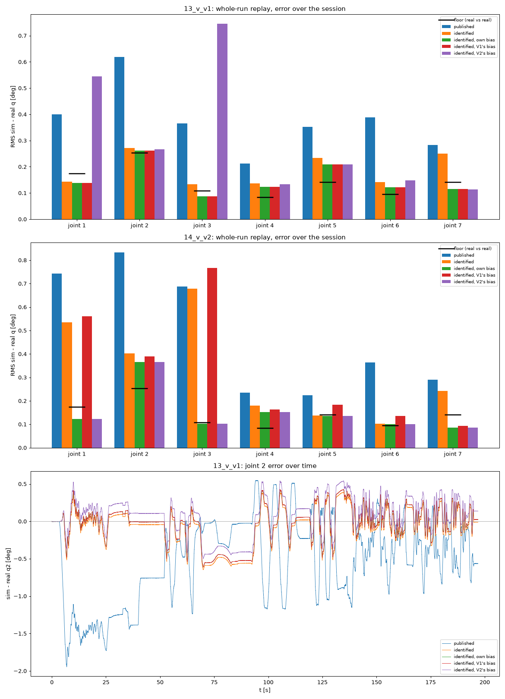
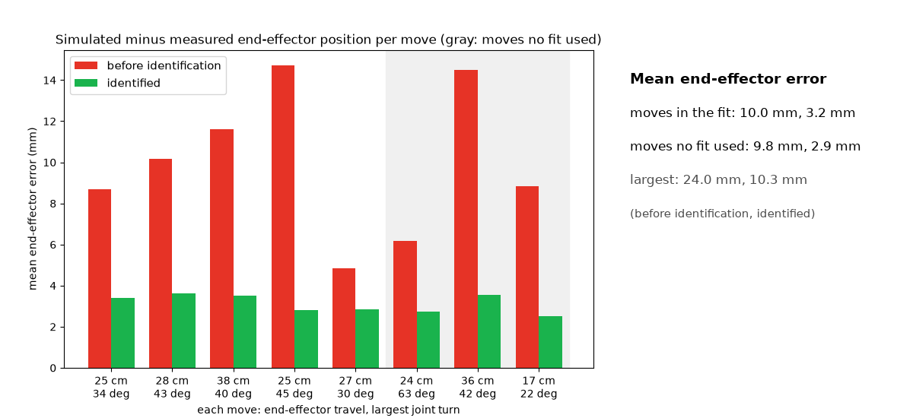

# Results on our Panda

Our robot: a Franka Emika Panda (production 2019, system version with FCI
server version 4, libfranka 0.8.0) with the Franka Hand (0.73 kg in Desk),
controlled from a PC without a real-time kernel. Joint impedance kp 40, kd
20 on every joint. The campaign ran on 2026-10-28 (19 runs, 36 minutes of
motion); `run_all.sh` makes every file here from its logs.

## Link inertials (`inertial/`)

Six Fourier runs under Franka's joint position controller. A fit that stays
physically consistent predicts the measured joint torques of a held-out
trajectory to 0.05-0.23 N m RMS per joint; Franka's published inertials miss
by up to 3.0 N m (joint 2) and 2.6 N m (joint 4). At rest at eight other
poses, the fit agrees with the measured torques as well as Franka's own
(closed-source) model does.

| Link | 1 | 2 | 3 | 4 | 5 | 6 | 7 |
| --- | --- | --- | --- | --- | --- | --- | --- |
| Mass (kg), Franka's published | 2.79 | 2.54 | 2.25 | 2.20 | 2.29 | 1.35 | 0.36 |
| Mass (kg), identified | 2.69 | 1.65 | 2.30 | 2.51 | 2.47 | 1.55 | 0.83 |

The torques fix only 43 combinations of the 70 inertial parameters, so
single masses are not unique; the fit keeps every combination the data
cannot see at Franka's values. The mass matrix and the gravity torques are
what the data determine.

## Joints (`joints/`, `model.json`)

Fitted on 10 runs under joint impedance (four repeats of a reference
session and six pose sessions), with the identified inertials and the
delays below, starting from the published values.

| Joint | 1 | 2 | 3 | 4 | 5 | 6 | 7 |
| --- | --- | --- | --- | --- | --- | --- | --- |
| Dry friction (N m) | 0.723 | 1.104 | 0.637 | 0.829 | 0.611 | 0.587 | 0.445 |
| Damping (N m s/rad) | 3.19 | 1.69 | 4.94 | 0.58 | 0 | 0 | 0 |
| Armature (kg m^2) | 0.195* | 0.195* | 0.195* | 0.195* | 0.088 | 0.083 | 0.088 |
| Torque bias, center (N m) | 0.19 | 0.35 | 0.19 | 0.06 | 0.03 | -0.03 | 0.13 |
| Torque bias, +- half-width (N m) | 0.34 | 0.21 | 0.30 | 0.30 | 0.20 | 0.18 | 0.16 |

\* Not identifiable from these slow runs (any value from 0.02 to 0.4 moves
the replays by less than 0.003 deg); left out of the fit at the FR3's
published value.

**Controller delays**: the robot's measured joint velocity is 3 ms late, a
torque command acts 2 ms after it is sent, and libfranka low-pass filters
the command (100 Hz) and limits its rate (1 N m per ms).

## Validation (`validate/`)

Whole runs at the two held-out poses H1 and H2 (three minutes each), which
no fit saw, replayed from their first measured state; error of the
simulated joint angles over the session (RMS, deg). The floor is how far
four repeats of one session on the robot land from each other. "Published
values" are Franka's inertials, the nominal joint values and an ideal
controller (no delays), what a simulation of the Panda usually starts from.

| Joint | 1 | 2 | 3 | 4 | 5 | 6 | 7 |
| --- | --- | --- | --- | --- | --- | --- | --- |
| Floor: the robot against itself | 0.17 | 0.25 | 0.11 | 0.08 | 0.14 | 0.10 | 0.14 |
| H1, published values | 0.40 | 0.62 | 0.37 | 0.21 | 0.35 | 0.39 | 0.28 |
| H1, identified, with H1's bias | 0.14 | 0.26 | 0.09 | 0.12 | 0.21 | 0.12 | 0.12 |
| H2, published values | 0.74 | 0.83 | 0.69 | 0.24 | 0.22 | 0.36 | 0.29 |
| H2, identified, with H2's bias | 0.12 | 0.37 | 0.10 | 0.15 | 0.14 | 0.10 | 0.09 |

The bias changes with the pose: with each other's bias, H1 and H2 miss by
0.54-0.56 deg on joint 1 and 0.75-0.77 deg on joint 3. So a simulation
should draw it for each episode from the range in `model.json`, which
covers the 13 runs at eight poses plus 0.1 N m on each side.

## Large moves (`replay/`)

The slow straight-line moves between the poses (end effector 17-38 cm,
joints up to 22-63 deg), replayed from their first measured state, with the
bias at the center of its range: the end effector misses the robot's by
3.2 mm on average on the moves in the fit and 2.9 mm on three moves no fit
saw, against 10.0 and 9.8 mm with the published values (largest error
10.3 mm against 24.0 mm).

`replay/real_vs_sim.mp4` (and its GIF) shows the three moves no fit used,
one after the other, each from the robot's measured state at its start: the
robot's measured joint angles and the simulations of the identified model
(green) and of the published values without delays (red) on the same
commands, at true scale.

## Files

| Path | Content |
| --- | --- |
| `model.json` | The identified model: link inertials, joint values, delays, torque bias range (`panda_sysid.simmodel`) |
| `workspace/` | The eight hand-guided corners (`corners.json`) and the box the campaign stays in |
| `inertial/` | The inertial fit (`params.json`, `model.json`), its held-out torques (`fit.png`) and static check (`static.png`) |
| `joints/` | The joint fit: start, fitted values and confidence intervals (`params.json`), its log, `model.json` |
| `bias/` | The bias each impedance run needs with the joint values fixed (`bias_per_run.json`) |
| `validate/` | Whole-run replays of H1 and H2 against the floor (`validate.json`, `validate.png`) |
| `replay/` | End-effector errors on the large moves (`moves.json`, `moves.png`) and the video of one |
| `run_all.sh` | Every fit above, in order, from the campaign's logs in `data/campaign` |
